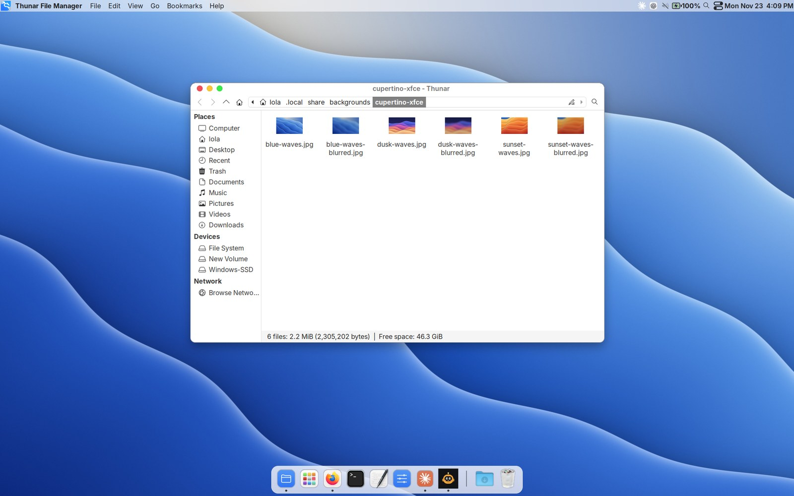
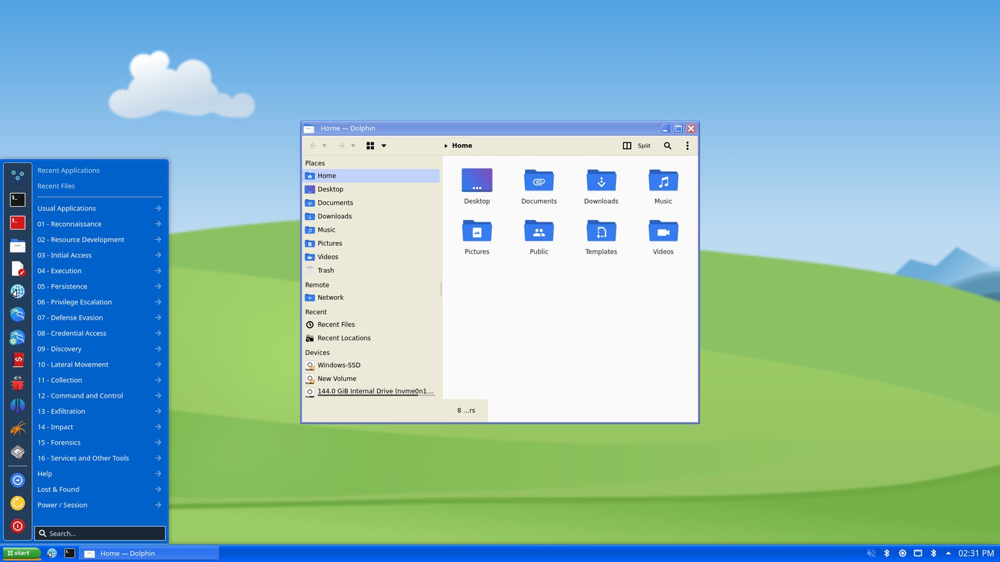

# kali-looks

Dress your normal Kali (Xfce) desktop as **macOS**, and pick **macOS Tahoe**, **Windows XP** or **Windows 7** at the login screen next to it. Each of those three is its own login session with its own settings, built on the most faithful replica that exists for it. Built on Kali Linux (Xfce 4.20, Plasma 6.7, X11).

```bash
git clone https://github.com/iiCiel/kali-looks.git
cd kali-looks
./looks.sh install          # puts the `looks` command in ~/.local/bin

looks setup xfce            # macOS for your normal Kali desktop (run it inside Xfce)
looks setup macos           # each takes a few minutes and asks for your password
looks setup winxp
looks setup win7            # compiles AeroThemePlasma the first time (10-30 min)
looks sessions              # puts them on the login screen
```

Then log out and choose a look from the login screen's session menu. To change looks later, open **Switch Look** from any of them (or run `looks switch`): it logs you out with the next look preselected.

| macOS (Xfce) | macOS Tahoe | Windows XP | Windows 7 |
|---|---|---|---|
|  |  |  |  |

## The looks

kali-looks doesn't draw its own imitation. It installs the best existing project for each look, at a pinned, tested version, into that look's session only.

| Look | Built on | What you get |
|---|---|---|
| **macOS (Xfce)** | [looks/xfce](looks/xfce) (formerly cupertino-xfce), with [WhiteSur](https://github.com/vinceliuice/WhiteSur-gtk-theme) by Vince Liuice and [Plank Reloaded](https://github.com/zquestz/plank-reloaded) | Your normal Kali desktop as macOS: global menu bar, Control Center, magnifying dock, Spotlight, Launchpad, Mission Control, light and dark mode, blur and rounded corners, Mac shortcuts, login screen and boot splash. It has no session of its own and installs into your own Xfce settings; `looks remove xfce` puts them back. Options and details: [looks/xfce/README.md](looks/xfce/README.md) |
| **macOS Tahoe** | [macOS Tahoe Shell for KDE](https://github.com/lestercorderomurillo/macos-tahoe-liquid-kde) by Lester Cordero Murillo and contributors | Menu bar with the app's own menus, Control Center, Liquid Glass dock with magnification, Launchpad, Spotlight-style search, SF Pro, Tahoe icons, cursors, sounds and wallpapers, rounded windows with traffic-light buttons. kali-looks adds what a real Tahoe Mac has on top: the menu bar on every screen with Battery, Wi-Fi, Spotlight, Control Center and the clock, Finder's full menu, light app colors, and the Tahoe wallpaper on the desktop and lock screen |
| **Windows XP** | [XPlasma Plus](https://github.com/ergosteur/XPlasma-Plus), a fork of hotsocket's [XPlasma](https://tangled.org/hotsocket.fyi/xplasma) | Renders XP's real Luna visual style: Start menu, taskbar and tray, window borders, Qt and GTK controls, Tahoma, XP icons, pointers and sounds, Bliss, XP logout dialogs and lock screen |
| **Windows 7** | [AeroThemePlasma](https://github.com/aeroshell-desktop/aerothemeplasma) by the AeroShell project | Aero glass, Superbar, Start orb and menu, Aero Peek and Snap, Windows 7 frames, icons, cursors, sounds, Segoe UI |

Left out of the session looks on purpose, because they'd reach outside the look's own session: Firefox theming, login-screen themes (Kali uses LightDM) and boot splashes. The Xfce look does theme those, since it's your main desktop (skip them with `looks setup xfce --no-firefox --no-login --no-boot-splash`).

## How the sessions stay separate

- `~/.config` becomes a link. Your own settings (Xfce, and every app) live in `~/.local/share/kali-looks/config/base`; each look has its own folder next to it.
- A look's folder holds that look's desktop settings and links back to your own settings for everything else, so Firefox, Chrome, VS Code, Claude and the rest are the same in every session. App folders created while you're in a look move to your own settings automatically.
- A small hook in `~/.xsessionrc` points `~/.config` at the right folder before each session starts. Xfce gets exactly the folder it always had.
- The few desktop settings that live outside `~/.config` (the GTK 2 theme in `~/.gtkrc-2.0` and the default pointer) are swapped the same way, so a look's pointer never shows up in Xfce.
- Sessions that start without `~/.xsessionrc` (Plasma on Wayland, Xfce on Wayland, the plain Plasma session) are hidden from the login screen, since they'd run on whichever look's settings were used last. `looks sessions remove` brings them back.
- A remote desktop session (Chrome Remote Desktop) always uses your own settings and never moves `~/.config`.
- `looks setup` runs each look's installer inside a hidden session (its own X display and D-Bus), so your screen isn't touched while it installs.
- Every screen of a look, and its lock screen, gets the look's wallpaper, also a screen you plug in later (no Plasma "Next" or Kali blue). `looks wallpaper` fills in any screen that still shows it.
- Desktop portals (which tell apps light or dark, and open file dialogs) restart with each look's settings.
- `looks reset <look>` starts a look over from scratch (the old settings are kept in a backup). `looks sessions remove` turns `~/.config` back into a plain folder.

## Fewer password prompts (optional)

`looks auth` installs a polkit rule: after you type your password once, admin prompts from your desktop are skipped for 30 minutes. It covers any `pkexec` prompt, not only kali-looks, so leave it off on a machine you share. The window only opens or extends when you type your password, never on its own, and it ends at reboot. `looks auth remove` takes it out.

## Windows 7: read this first

AeroThemePlasma is a deep modification of Plasma, not a theme:

- It's compiled from source and installs into `/usr`, including its **own build of `libplasma`** that replaces Kali's.
- When a Kali update upgrades Plasma, the Windows 7 session stops working until you run `looks rebuild win7`.
- `looks remove win7` deletes everything it installed and reinstalls the Kali packages it replaced.
- Segoe UI comes from your own Windows install if the computer has one (read-only); otherwise Microsoft's open-licence stand-in, Selawik.
- The wallpaper is an original Aero-style one. To use another, save it as `~/.local/share/kali-looks/win7-wallpaper.jpg` and run `looks setup win7`.

## Credits and licences

kali-looks itself is MIT, including looks/xfce and its wallpapers, boot splash, dock themes and Control Center. The projects it installs keep their own licences and credits:
- WhiteSur GTK and Firefox themes: MIT; WhiteSur icons and cursors: GPL-3.0; Plank Reloaded: GPL-3.0 / LGPL-2.1 (more in [looks/xfce/README.md](looks/xfce/README.md#credits))
- macOS Tahoe Shell for KDE: GPL-3.0
- XPlasma Plus / XPlasma: GPL-3.0. Its XP artwork, fonts and sounds are Microsoft's and are downloaded from XPlasma Plus' release, not from this repository.
- AeroThemePlasma: AGPL-3.0
- Selawik: SIL Open Font License

macOS and Windows are trademarks of Apple and Microsoft. This project isn't affiliated with either.
