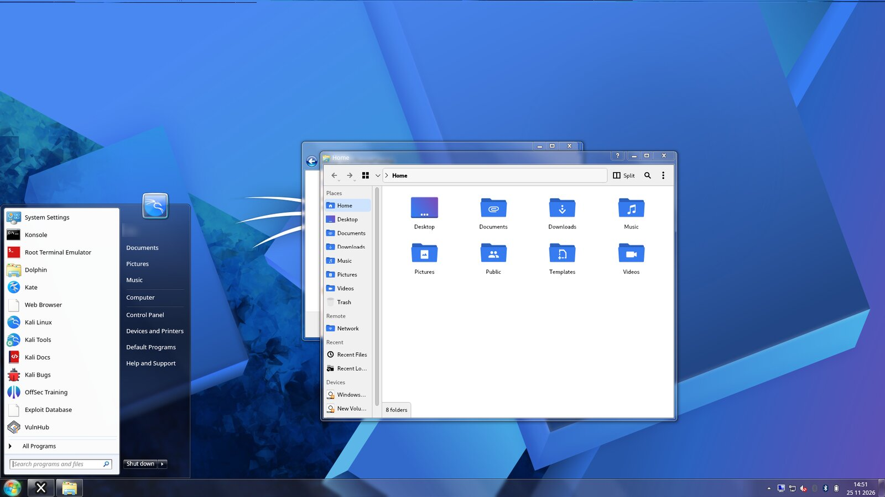

# kali-looks

Switch KDE Plasma between whole-desktop looks with one command: **macOS**, **Windows XP** and **Windows 7**. Built on Kali Linux (Plasma 6.7), works on Debian-based Plasma desktops.

```bash
git clone https://github.com/iiCiel/kali-looks.git
cd kali-looks
./looks.sh install          # puts the `looks` command in ~/.local/bin

looks list                  # what's available, and what's active
looks apply macos           # or: looks apply macos dark
looks apply winxp
looks apply win7            # builds it the first time, then log out and back in
looks revert                # your own desktop back, exactly as it was
looks sessions              # or: pick each look from the login screen instead
```

| macOS | Windows XP | Windows 7 |
|---|---|---|
|  |  |  |

Run `looks apply macos` / `winxp` from a terminal inside a Plasma session: the switch happens live. Using Xfce? See [cupertino-xfce](https://github.com/iiCiel/cupertino-xfce) for the macOS look there.

## The looks

| Look | What you get | Built from |
|---|---|---|
| **macOS** (`light` / `dark`) | Menu bar with the focused app's name and File/Edit/View menus on **every screen**, a magnifying dock with Downloads and Trash, Mac window buttons on the left, Spotlight on Super+Space (KRunner), Mission Control on Ctrl+Up (KWin Overview), Launchpad in the dock and on F4, original wave wallpapers. | [WhiteSur-kde](https://github.com/vinceliuice/WhiteSur-kde), [WhiteSur GTK/icons/cursors](https://github.com/vinceliuice), [Plank Reloaded](https://github.com/zquestz/plank-reloaded), [Window Title](https://github.com/dhruv8sh/plasma6-window-title-applet) |
| **Windows XP** (`luna`) | Blue Luna taskbar with a green start button on every screen, cascading start menu, XP window borders and buttons, Luna-styled Qt and GTK apps (Firefox too), green-hills wallpaper. | [Expose](https://www.opencode.net/phob1an/expose) by phob1an, [Windows XP for GTK](https://github.com/B00merang-Project/Windows-XP) by B00merang |
| **Windows 7** (`aero`) | The full Aero desktop: glass, Superbar, start orb and menu, Aero window frames, gadgets, sounds, its own login session. | [AeroThemePlasma](https://github.com/aeroshell-desktop/aerothemeplasma) |

## Pick a look at the login screen

```bash
looks sessions          # one-time: adds the looks to the login screen (asks for your password)
```

Log out and choose **macOS (KDE Plasma)**, **Windows XP (KDE Plasma)** or **Windows 7 (AeroThemePlasma)** in the login screen's session menu. Each session keeps its own settings: what you change in the macOS session stays there, and plain Xfce or Plasma sessions get their own settings back. That works through a small hook in `~/.xsessionrc` that swaps the desktop settings before the session starts. The first login into a look sets it up automatically. `looks sessions remove` takes it all off again. X11 sessions only; Wayland sessions don't run `~/.xsessionrc`.

## How switching works

- The first `looks apply` saves your Plasma setup (panels, theme, colours, fonts, shortcuts, GTK settings) to `~/.local/share/kali-looks/original/`. `looks revert` puts it all back.
- Each look's themes are downloaded from their upstream projects at **pinned versions** (the ones tested here), into your home folder. No upstream install script is run.
- macOS and XP switch live inside Plasma. Each is a Plasma global theme plus a layout script, so they also show up under *System Settings → Global Theme*.
- Windows 7 is its own login session. `looks apply win7` builds it once (10–30 minutes) and preselects it for your next login; pick *Plasma* at the login screen to come back.

## Windows 7: read this first

AeroThemePlasma is a deep modification of Plasma, not a theme:

- It's compiled from source and installs into `/usr`, including its **own build of `libplasma`** that replaces Kali's.
- When a Kali update upgrades Plasma, the Windows 7 session stops working until you run `looks rebuild win7`. `looks apply win7` notices this and rebuilds by itself.
- `looks remove win7` deletes everything it installed and reinstalls the Kali packages it replaced.
- It pulls in about 230 development packages to build.

## Packages it installs

Only what's missing, with your password:

- **macOS:** `qt-style-kvantum rofi fonts-inter appmenu-gtk3-module`, and Plank Reloaded from its author's repo, pinned by SHA-256, on X11.
- **XP:** `qt-style-kvantum fonts-dejavu-core`.
- **Windows 7:** the build dependencies in [`looks/win7/deps.txt`](looks/win7/deps.txt).

## Known issues

- **Wayland:** macOS uses a floating dock panel instead of Plank, without magnification. Windows 7's Wayland support is incomplete upstream.
- Some shortcuts (Spotlight, Mission Control, Launchpad) take effect after logging out and back in.
- XP: the start button is an original drawing, and the wallpaper is phob1an's original art. Microsoft's logo and the "Bliss" photo are their property and aren't included.

## Credits and licences

kali-looks itself is MIT. The themes it downloads keep their own licences:
- WhiteSur by vinceliuice: GPL-3.0
- Expose by Mark Whittaker (phob1an): GPL-2.0+ / CC-BY 4.0
- Windows XP GTK by B00merang: GPL-3.0
- AeroThemePlasma by the AeroShell project: AGPL-3.0
- Plank Reloaded: GPL-3.0
- Window Title applet by Dhruvesh Surolia: GPL-2.0

The macOS wallpapers are original, made for [cupertino-xfce](https://github.com/iiCiel/cupertino-xfce).

Not affiliated with Apple or Microsoft. macOS, Windows, Windows XP and Windows 7 are trademarks of their owners. They're named here only to describe the style.
