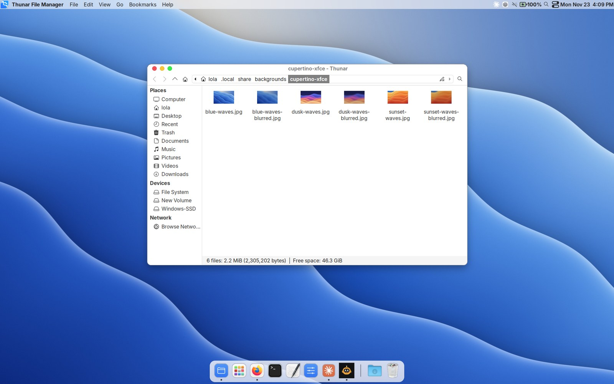
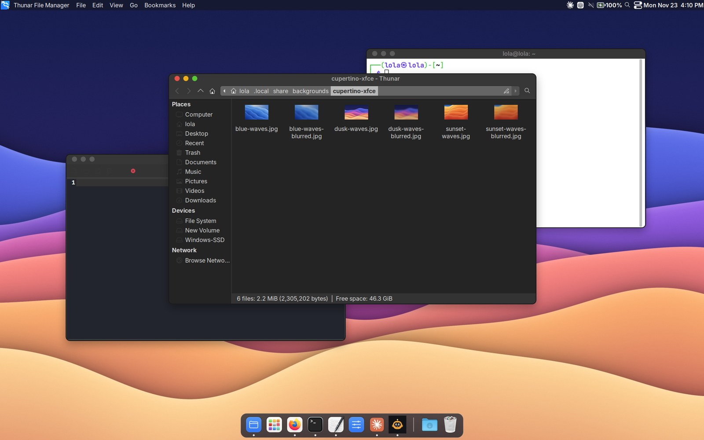
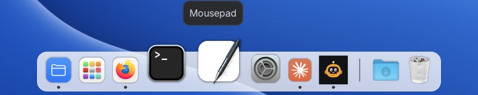
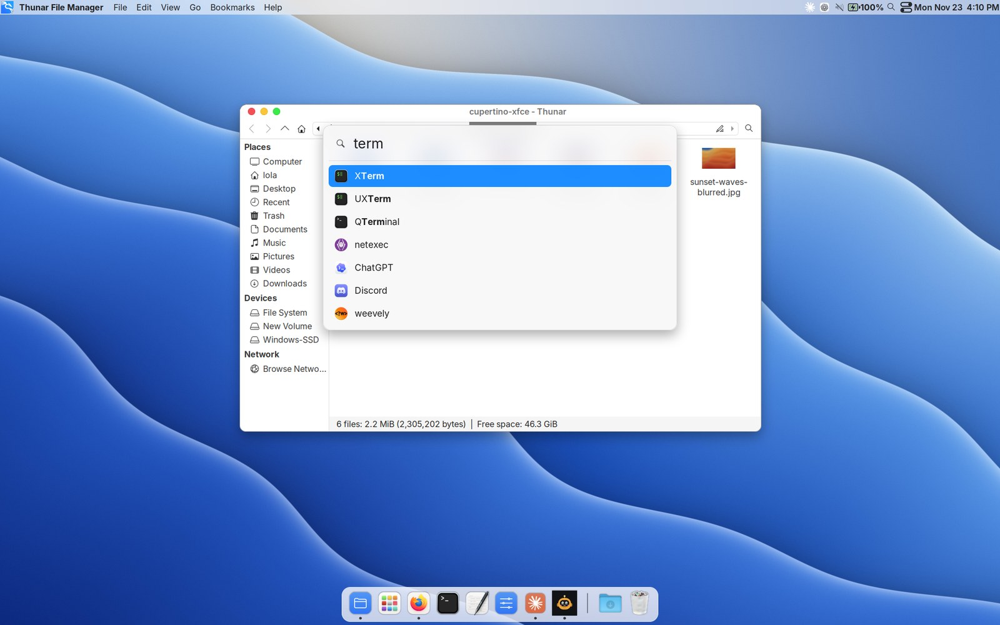
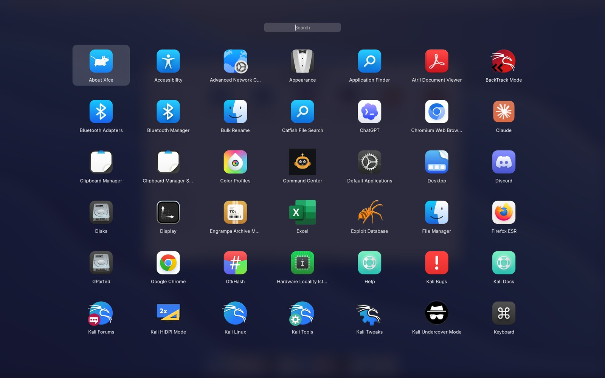
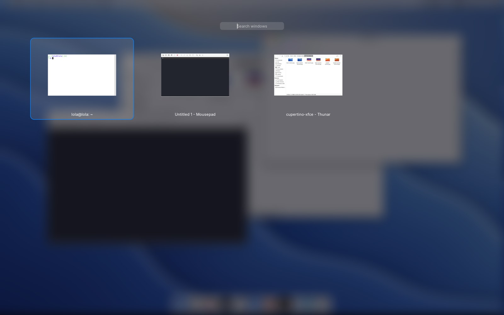
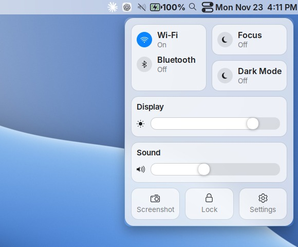
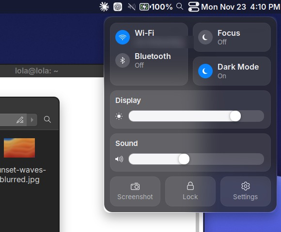

# cupertino-xfce

**Make Xfce look and feel like macOS, with one script.**
Built on Kali Linux (Xfce 4.20) and tested on a clean Ubuntu 26.04 Xfce system. Aimed at Kali, Debian 13 and other recent Debian-based Xfce setups.



## What you get

| | |
|---|---|
| **Global menu bar** | The focused app's name and **File / Edit / View…** menus in the top bar. Apps without menus of their own (Firefox, the desktop) get standard Mac ones. On the right, like macOS: Wi-Fi, sound, battery, a Spotlight icon, Control Center and the date. One menu bar on every monitor, including ones you plug in later (they get the wallpaper too); the dock follows the screen you're using. |
| **Control Center** | Click the toggles icon next to the clock: Wi-Fi, Bluetooth, Focus (Do Not Disturb), Dark Mode, display brightness, volume, plus Screenshot / Lock / Settings. |
| **Magnifying dock** | Icons grow as your mouse passes over them, like on a Mac. Floating, frosted and rounded, with dots under running apps, and Downloads and Trash at the right end. Hides when a window covers it ([Plank Reloaded](https://github.com/zquestz/plank-reloaded)). |
| **Spotlight** | **Super+Space** to search and launch apps. |
| **Launchpad** | Full-screen app grid, pinned in the dock. |
| **Mission Control** | **Ctrl+Up** shows live thumbnails of every open window; type to filter, Enter to switch. |
| **Light and dark mode** | Switch from Control Center, or `cupertino-xfce-mode toggle`. The theme, menu bar, dock, Spotlight, notifications, terminal and wallpaper all change together. |
| **Blur, rounded corners, shadows** | Frosted glass behind the menu bar, dock and notifications; rounded windows; soft shadows and fades (picom). |
| **Mac shortcuts** | Super+Q close · Super+Tab switch · Ctrl+Super+Q lock · Super+Shift+3 / 4 / 5 screenshots, saved to the Desktop as “Screenshot 2026-11-23 at 4.08.33 PM.png”. |
| **WhiteSur look** | macOS-style windows with buttons on the left, icons, cursors and the Inter font ([WhiteSur](https://github.com/vinceliuice/WhiteSur-gtk-theme)). |
| **Firefox** | WhiteSur's Safari-style Firefox theme. |
| **Terminal** | macOS Terminal-style colours (light and dark) and JetBrains Mono in QTerminal. |
| **Notifications** | Rounded, frosted notifications in the top-right corner. |
| **Login and lock screen** | Frosted, rounded login box over a blurred wallpaper. |
| **Boot splash** | Black screen with a clean progress bar (and a matching password field for encrypted disks). |
| **Original wallpapers** | Three wave wallpapers made for this project: blue (light mode), dusk (dark mode) and sunset. |
| **Full undo** | Everything is backed up first; `./uninstall.sh` puts it all back. |

| Dark mode | Magnifying dock |
|---|---|
|  |  |
| **Spotlight** (Super+Space) | **Launchpad** |
|  |  |
| **Mission Control** (Ctrl+Up) | **Control Center**, light and dark |
|  |   |

## Install

```bash
git clone https://github.com/iiCiel/cupertino-xfce.git
cd cupertino-xfce
./install.sh --dry-run   # optional: check your system, change nothing
./install.sh             # light mode   (or: ./install.sh --dark)
```

Run it as your normal user from a terminal **inside your Xfce session**. It asks for your password when it needs root: once to install packages, and once for the login screen, terminal colours and boot splash. Rebuilding the boot splash takes about a minute.

Then **log out and back in** so every app sends its menus to the menu bar.

### Options

```
--light            Light mode (default)
--dark             Dark mode
--docklike         Use Xfce's Docklike panel as the dock (no magnification) instead of Plank
--no-global-menu   Skip the File/Edit/View menu bar
--no-effects       Skip picom (blur, rounded corners, shadows)
--no-login         Leave the login screen alone
--no-boot-splash   Leave the boot splash alone
--no-firefox       Leave Firefox's look alone
--no-terminal      Leave QTerminal's colours and font alone
--dry-run          Check your system and show what would change, then stop
-y, --yes          Don't ask for confirmation
```

Set `CUPERTINO_ROOT=pkexec` to get a graphical password prompt instead of `sudo`.

## Uninstall

```bash
./uninstall.sh           # restore your desktop as it was before the first install
./uninstall.sh --purge   # …and also remove the themes, wallpapers and added packages
```

Backups live in `~/.local/share/cupertino-xfce/backups/`. Each holds your previous panel layout, the original value of every setting the installer touched, your `gtk.css`, `qterminal.ini`, Firefox `chrome` folder and `user.js`, and your original login-screen config and boot-splash name. Installing twice (say light, then dark) is fine: the uninstaller walks every backup so your original settings win.

## What it changes

- **Dock**: [Plank Reloaded](https://github.com/zquestz/plank-reloaded) from your distro if it has it; otherwise its author's Debian build from `zquestz.github.io/ppa/debian`, pinned by SHA-256. This is the one package that doesn't come from your distro or Debian; use `--docklike` to skip it.
- **Packages** (only the missing ones): `bzip2 picom rofi fonts-inter fonts-jetbrains-mono python3-gi gir1.2-gtk-3.0 xfce4-panel-profiles xfce4-docklike-plugin xfce4-whiskermenu-plugin xfce4-pulseaudio-plugin xfce4-notifyd xfce4-power-manager-plugins xfce4-screenshooter appmenu-registrar appmenu-gtk3-module gir1.2-wnck-3.0 xdotool wmctrl x11-utils git curl xz-utils x11-xserver-utils xdg-user-dirs`.
- **Global-menu plugin** (`xfce4-appmenu-plugin`): from your distro if it has it. Kali doesn't, so the installer fetches Debian's official build from [snapshot.debian.org](https://snapshot.debian.org) and checks its SHA-256 before installing.
- **WhiteSur** theme, icons, cursors and Firefox theme: downloaded from upstream at a pinned commit, archives checksum-verified. Their install scripts aren't run.
- **Panels**: replaced with a menu bar per monitor and a dock, via `xfce4-panel-profiles`. Your old layout is saved first.
- **Settings** (`xfconf`): GTK/window theme, icons, cursor, font, window buttons, wallpaper, notifications, keyboard shortcuts, global-menu settings, compositor.
- **Your files**: a marked block in `~/.config/gtk-3.0/gtk.css`; `gtk-enable-mnemonics` in `~/.config/gtk-3.0/settings.ini`; colour scheme, font and transparency in `~/.config/qterminal.org/qterminal.ini`; Firefox profiles get a `chrome` link and a marked block in `user.js`.
- **New files**: Plank's dock settings and `~/.config/plank/dock1/launchers/`, two Plank themes in `~/.local/share/plank/themes/`, `~/.config/cupertino-xfce/`, `~/.local/share/cupertino-xfce/`, `~/.local/bin/cupertino-xfce-mode`, `~/.local/bin/cupertino-control-center`, `~/.local/bin/cupertino-menud`, the Launchpad entry, a hidden "Finder" entry that names the desktop in the menu bar, the `Cupertino-Notify` notification theme, and autostart entries for picom, the menu helper and a one-time setup step.
- **System (root)**: a `WhiteSur-Login` theme, blurred background and a few keys in `/etc/lightdm/lightdm-gtk-greeter.conf` (only with the LightDM GTK greeter); two QTerminal colour schemes in `/usr/share/qtermwidget6/color-schemes`; a `cupertino` Plymouth theme set as default (only if Plymouth is active, plus `plymouth-label` if missing), which rebuilds your initramfs.

## Which apps get the global menu?

| Their own menus in the top bar | Standard Mac menus from `cupertino-menud` |
|---|---|
| GTK3 apps: Files (Thunar), Mousepad, Xfce settings, most Xfce apps | Firefox (Debian/Kali builds can't export their menus): File, Edit, View, History, Bookmarks, Window, Help |
| Qt apps such as QTerminal | The desktop ("Finder"): File, Edit, View, Go, Window, Help |
| LibreOffice | Apps with no menu bar (GTK4/libadwaita, terminals like kitty), and Java apps such as Burp Suite (which keep their in-window menus too) |
| Most Electron/Chromium apps that have a menu bar | |

The standard menus work by sending the app its usual keyboard shortcut (Copy sends Ctrl+C, New Tab sends Ctrl+T), so they do what the app's own shortcut does.

## Known issues

- **Restart running apps** after installing. Turning the global menu on while some Electron apps are open can make them close; they reopen fine.
- **Wayland isn't supported.** Use the normal Xfce (X11) session.
- **picom needs working OpenGL.** If it can't start, the installer falls back to Xfce's own compositor (no blur or rounded corners) and tells you.
- **Ctrl+Up** opens Mission Control everywhere, like on a Mac, so apps that use Ctrl+Up themselves won't see it.
- Extra monitors' menu bars have sound, battery (needs `xfce4-battery-plugin`, which Kali includes), Spotlight, Control Center and the clock. The tray icons (Wi-Fi, Bluetooth, apps' own icons) can only be shown once per desktop, so they stay on the main screen's bar.
- A wallpaper picked in Desktop Settings is copied to every screen and workspace.
- The app name in the menu bar isn't bold: the menu plugin orders its items differently per app, so a bold rule would sometimes land on the wrong menu.
- Menus no longer show underlined shortcut letters (`gtk-enable-mnemonics=false`); Alt+letter menu shortcuts inside GTK apps are off too.
- A QTerminal window that's open during install keeps its old colours until you open a new one after logging back in.
- With `--docklike`, some apps show as a second dock icon instead of lighting up their pinned one, when their window class doesn't match their `.desktop` file.
- The dock reveals when the pointer touches the bottom edge while a maximised window covers it, the same as macOS's auto-hide.

## On KDE Plasma?

[kali-looks](https://github.com/iiCiel/kali-looks) does the same for KDE Plasma, and can switch between macOS, Windows XP and Windows 7 looks with one command.

## Credits

- [WhiteSur GTK theme](https://github.com/vinceliuice/WhiteSur-gtk-theme) (MIT), [WhiteSur Firefox theme](https://github.com/vinceliuice/WhiteSur-firefox-theme) (MIT), [WhiteSur icons](https://github.com/vinceliuice/WhiteSur-icon-theme) (GPL-3.0) and [WhiteSur cursors](https://github.com/vinceliuice/WhiteSur-cursors) (GPL-3.0) by Vince Liuice. Downloaded from upstream, not redistributed here.
- [vala-panel-appmenu](https://gitlab.com/vala-panel-project/vala-panel-appmenu) (LGPL-3.0): the global-menu plugin, packaged by Debian.
- [Plank Reloaded](https://github.com/zquestz/plank-reloaded) (GPL-3.0 / LGPL-2.1) by Josh Ellithorpe and contributors: the dock.
- [Docklike Taskbar](https://docs.xfce.org/panel-plugins/xfce4-docklike-plugin/start), [picom](https://github.com/yshui/picom), [rofi](https://github.com/davatorium/rofi), [Plymouth](https://www.freedesktop.org/wiki/Software/Plymouth/), [Inter](https://rsms.me/inter/), [JetBrains Mono](https://www.jetbrains.com/lp/mono/).
- Inspired by [SmallSur](https://github.com/jothi-prasath/smallsur) and Xfce's "Cupertino" panel profile.

## License

MIT. See [LICENSE](LICENSE). The wallpapers, boot splash, dock themes, Control Center app and icon are original to this project and covered by the same license.

Not affiliated with or endorsed by Apple Inc. macOS is a trademark of Apple Inc. No Apple artwork, logos, fonts or wallpapers are included.
